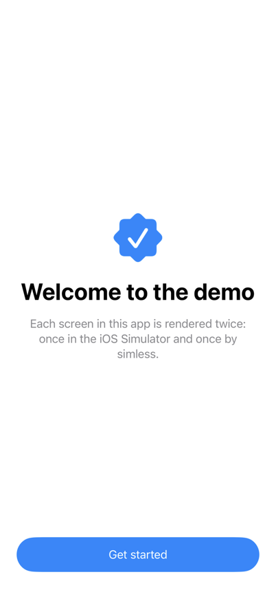
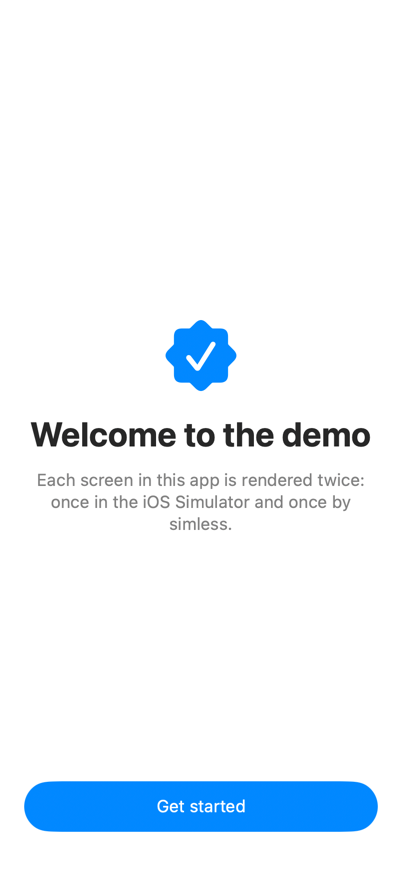
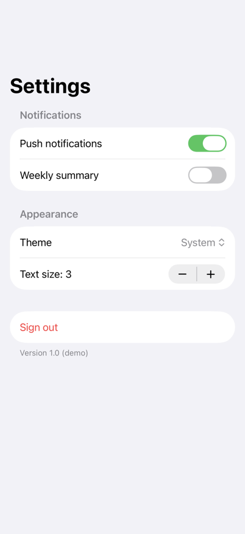
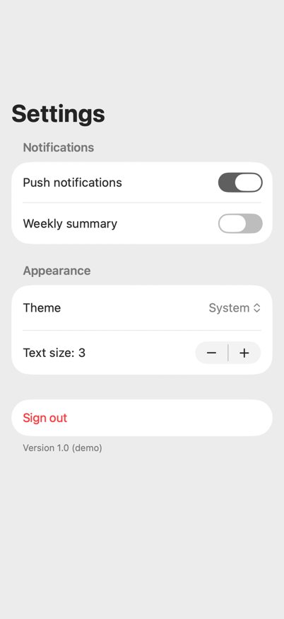

# simless

**Simulator-free, headless SwiftUI checks for AI coding agents.**

Your real iOS app runs natively on your Mac as an invisible render host. Agents render any screen as a compact accessibility tree in milliseconds, hot-reload edited views in about 2 seconds, and run unit tests and your existing XCUITest UI tests, all without booting an iOS Simulator. Many agents across many projects can work in parallel on one Mac.

```
$ simless reload --render Welcome.sheet
reloaded (live) in 1.9s: compile 1.7s + apply 0.2s; files edited since `simless up`: WelcomeSheet.swift
Welcome.sheet · light · iphone 402×874 · 25 ms · patch 1
  traits: compact/regular size class, idiom pad, safe area top 62 bottom 34
  header  "Welcome to Notes" #welcome.title  @89.3,403.8 223.5×81.5
  text    "Your notes stay on this device and sync with iCloud."  @26.8,493.3 348.5×64.5
  button  "Get Started" #welcome.start  @24,779.5 354×36.5
  issues (1):
    ⚠ button "Get Started" tap target 354×36 is smaller than 44×44
```

## Why

Coding agents check UI changes by building for the iOS Simulator, installing, launching and taking screenshots. Each agent pays for its own booted simulator (we measured ~2.2 GB of private memory and ~210 processes per simulator running a real app) plus its own `xcodebuild`. With 4–5 agents in parallel, a 32 GB Mac swaps and everything slows to a crawl.

simless replaces that loop:
- **No simulator:** the app's iOS slice runs natively on Apple Silicon ("Designed for iPad"). It's your real app target, views and dependencies, at ~30 MB per host.
- **Headless:** no windows, no Dock icons, no focus stealing, including during installs and test runs.
- **Text first:** agents read an accessibility tree (~150 tokens per screen), plus automatic checks for unlabeled controls, off-screen elements, small tap targets and overlaps. PNGs are produced only on request.
- **Hot reload:** only the edited files are compiled into a patch and loaded into the running host.
- **Built for many agents:** one host per git worktree, coordinated with file locks, and everything cleaned up automatically.

## Results

Measured on a production SwiftUI app (~280 Swift files, several large Swift packages) on an M2 Pro MacBook Pro with 32 GB of RAM. Legacy means one iOS Simulator per agent, with an incremental `xcodebuild`, install, launch and screenshot for every check.

| | Legacy (simulator) | simless | |
|---|---|---|---|
| Edit → verified screen, 1 agent | 21.9 s | **2.2 s** | **10×** |
| Edit → verified screen, 5 agents in parallel | 37.4 s | **2.2 s** | **17×** |
| 5 agents start cold at once (per agent) | 732 s | **344 s** | 2.1× |
| Memory held by 5 agents (steady state) | 11.2 GB, 1,071 processes | **0.15 GB, 6 processes** | **~75×** |
| Peak load average, 5 agents starting cold | ~1,010 | **~82** | 12× |
| Unit tests (2 classes) | 13.1 s | **5.6 s** | 2.3× |
| Unit tests, whole suite (2,210 tests, build included) | 8.9 min | **5.8 min** | 1.5× |
| 20 named tests, nothing rebuilt | 40 s | **3.4 s** | 12× |
| UI tests (115 XCUITests, one simulator vs. 3 hidden hosts) | 51 min | **7.8 min** | 6.5× |

Legacy gets slower with every agent you add; simless stays at ~2 s per edit. The test rows are from a second production app (about 2,200 unit tests across 41 targets, most of them in a local Swift package), against an iPhone 17 simulator on iOS 26.5. The simulator's UI time is the sum of its test times on one simulator. Full method, caveats and reproduction steps: [docs/benchmarks.md](docs/benchmarks.md).

## Does it look the same?

Mostly. Here are screens from the [demo app](Examples/SimlessDemo), rendered by the iOS Simulator (the legacy workflow) and by simless:

| Welcome: iOS Simulator | Welcome: simless | Settings: iOS Simulator | Settings: simless |
|:-:|:-:|:-:|:-:|
|  |  |  |  |
| | ✓ matches within 2 pt | | ✗ toggle rows 6 pt taller, Mac accent color |

8 of 14 demo renders (7 screens, light and dark) match within 2 pt. The rest differ in row heights of `List` and `Form`, line breaks in long centered text, and system accent colors. [docs/fidelity.md](docs/fidelity.md) shows every screen side by side. Run `simless calibrate --png <dir>` to get the same comparison for your own app.

## Requirements

- An Apple Silicon Mac with Xcode 26 or later.
- A SwiftUI iOS app in an `.xcodeproj` (at the repository root or in a subfolder such as `ios/`), with an app-hosted unit-test target (simless installs hosts through it). Views can live in the app target or in local Swift packages; both hot-reload. Swift 5 and Swift 6 language modes, with or without MainActor default isolation, are supported.
- An **Apple Development** certificate, and the team's wildcard development profile ("iOS Team Provisioning Profile: \*") that includes this Mac. Xcode creates it the first time you run any app on "My Mac (Designed for iPad)". simless never registers anything in your developer account.

## Install

```sh
git clone https://github.com/abacusai/simless && cd simless
swift build -c release
ln -s "$PWD/.build/release/simless" ~/.local/bin/simless    # any directory on your PATH
simless skill install       # optional: Claude Code skill (see "Using it from AI agents")
```

## Set up an app (once per repository)

```sh
cd <your-app-repo>
simless init
```

This creates:
- `.simless.json`
- `<App>/Simless/SimlessKit.swift`: the render host. It's generated, `#if DEBUG` only, and does nothing unless simless launches the app.
- `<App>/Simless/SimlessFixtures.swift`: your screens.

It also adds one call to your `@main` App's `init()` (pass `--no-hook` to skip that):

```swift
#if DEBUG && os(iOS)
SimlessHost.startIfRequested()
#endif
```

Register the screens agents should be able to render, each in a deterministic state:

```swift
@MainActor
func simlessFixtures(_ r: SimlessRegistry) {
    r.add("Settings") { SettingsView().environmentObject(SettingsStore.preview) }
    r.add("NoteList.empty") { NoteListView(notes: []) }
    r.add("NoteList.long") { NoteListView(notes: .fixture(count: 50)) }
}
```

Then run `simless up`. If your project doesn't use synchronized folders, add the two files to the app target first. If app startup has side effects a background host shouldn't trigger (analytics, sync), guard them with `SimlessHost.isActive`.

### Live reload (optional, recommended)

```sh
simless agent install
```

Then grant **SimlessAgent** Full Disk Access (System Settings → Privacy & Security → Full Disk Access). This takes hot reload from about 10 s to about 2 s. The agent can do exactly one thing: copy a patch built by simless into the temp folder of a simless host's sandbox container. [Why it needs this](docs/architecture.md#5-simlessagent-and-its-security-model).

## Commands

```
simless init [--no-hook]          set up a repo
simless up                        build, install this worktree's host, start it
simless render <fixture|all>      accessibility tree + issues
      [--dark] [--device iphone|iphone-small|iphone-max|ipad] [--matrix] [--png <file|dir>] [--json]
      [--locale <lang>] [--text-size xs…xxxl|ax1…ax5] [--idiom phone]
simless reload [files...]         hot-reload everything edited since `simless up`
      [--render <fixture|all>] [--matrix] [--no-fallback]
simless test [Target/Class/method...|all]   unit tests on the Mac, local package tests included
      [--skip Target/Class/method]... [--timeout <seconds per test>] [--hosts <n>] [--jobs <tests at once>]
simless test ui [Target/Class/method...]   your XCUITest UI tests, without a simulator
      [--jobs <hosts>] [--device iphone|ipad|...] [--timeout <seconds per test>]
simless test --simulator-only     the tests marked as needing a simulator, and the xcodebuild command for them
simless calibrate [fixture]       compare renders with an iOS Simulator (boots one; run once per app)
      [--dark] [--png <dir>] [--runtime <iOS version>] [--sim-device <name>] [--idiom phone]
simless status                    hosts, slots, live-reload availability
simless down [--all]              stop hosts (they relaunch in ~1 s on next use)
simless clean [--all]             remove this worktree's host, slot and build cache (--all: everything)
simless agent install             install SimlessAgent (live reload)
simless skill install             install the Claude Code skill
simless version                   version, Xcode and macOS
```

`--matrix` renders light and dark on `iphone`, `iphone-small` and `ipad`.

`--locale hr` relaunches the host with that language and region (about 1 s), so one fixture covers every language. `--text-size ax5` sets the Dynamic Type size the view sees, and text scales with it like on an iPhone.

`simless test` prints failures and crashes as they happen, with the crash's message and file, and a progress line every 10 s. `simless test all` runs the app's test targets and every local package's, in warm hosts with tests in parallel. A big run is spread over several hosts by how long each target took last time (`--hosts`), because main-actor tests run one at a time per process. A test that crashes the host or runs longer than `--timeout` (default 600 s, like Xcode) is reported with its name and the crash's frames, and a fresh host runs only what didn't finish. A test that ran out of time only because the run was busy is run again alone, and reported as load if it passes. A `--skip` that didn't match anything gets a note with the id formats. Results go to `test-results.json` in the worktree's work folder (`simless status` shows where).

`simless test ui` runs the UI test targets' XCUITest code as it is: `XCUIApplication` with launch arguments and environment, queries, `tap`, `typeText`, swipes, coordinates, alerts, `performAccessibilityAudit`, screenshots. It spreads the tests over several hidden hosts (`--jobs`, default up to 4), and for every failure saves a screenshot and the element tree. See [UI tests](#ui-tests) for what it emulates and what still needs a simulator.

### Options in `.simless.json`

```json
{
  "checks": { "minTapTarget": 32, "ignore": ["\"Daily\" tap target", "Show Sidebar"] },
  "tests": {
    "timeout": 120, "skip": ["AppTests/DeviceOnlyTests"],
    "simulatorOnly": { "AppUITests/HealthUITests/testPermissionSheet": "the HealthKit sheet" },
    "uiJobs": 3, "uiTimeout": 180
  },
  "calibrate": { "runtime": "26.5", "device": "iPhone 17 Pro" },
  "idiom": "phone",
  "embeddedBundles": true
}
```

- `checks.minTapTarget`: the smallest tap target in points that isn't reported (default 44).
- `checks.ignore`: issues containing any of these strings aren't reported. Renders say how many were ignored.
- `tests.timeout` and `tests.skip`: defaults for `--timeout` and `--skip`.
- `tests.simulatorOnly`: tests that need a simulator, with the reason. They're skipped and counted apart, and `simless test --simulator-only` lists them. A test skipped with a reason that starts with "simulator only" counts too.
- `tests.hosts` and `tests.jobs`: test hosts running side by side (default: up to 4 when there are 4 or more targets), and tests running at once in each. `tests.uiJobs` and `tests.uiTimeout`: hosts for UI tests, and seconds one UI test may run.
- `tests.uiSources`: a UI test target's source folder, when it isn't a synchronized folder simless can find.
- `calibrate.runtime` and `calibrate.device`: the simulator `simless calibrate` compares against (default: the newest runtime, iPhone 17 Pro).
- `idiom`: `"phone"` renders phone canvases with the phone idiom (see below).
- `embeddedBundles`: `false` removes app extensions and the watch app from the slot.

## Using it from AI agents

**Claude Code:** run `simless skill install` once per machine. After that, "use simless for testing" is enough in any project. The skill teaches the agent to:
- set up a repo (`simless init`, writing fixtures),
- run the edit → `simless reload --render` loop,
- check variants with `--matrix`,
- fix the reported issues,
- say what still needs a simulator.

**Other agents:** add this to your `AGENTS.md`:

```md
## UI verification with simless (no simulator)
- `simless up` once per worktree. Never boot a simulator for screen checks.
- After editing SwiftUI views: `simless reload --render <Fixture>` (≈2 s). Read the tree and fix every issue.
- `simless render all --matrix` checks every screen in light/dark on iPhone, small iPhone and iPad.
- New screen or state? Register it in SimlessFixtures.swift with deterministic data.
- Use `--png <dir>` only when visual detail matters.
- Logic: `simless test <Target>/<Class>` (local package test targets work too, and `simless test all` runs every one).
- UI tests: `simless test ui` (or `simless test <UITarget>/<Class>`) runs the XCUITest code without a simulator.
  Mark tests that need a simulator (HealthKit, StoreKit, photo and file pickers, the watch) in
  `tests.simulatorOnly`, and run what `simless test --simulator-only` lists in a simulator.
- Tests that need a real device: gate them on `ProcessInfo.processInfo.isiOSAppOnMac` (or
  `SIMLESS_HEADLESS`), since `targetEnvironment(simulator)` is false on the Mac.
- Compile errors from `simless reload` point at your file:line.
- A pass is strong evidence, not proof. Run `simless calibrate` once per app to see which screens match
  the simulator. Say what still needs a simulator.
```

## Cleanup is automatic

- **Deleted worktrees:** every command removes the host, slot and build cache of any worktree that no longer exists.
- **Idle hosts:** a host exits after 30 idle minutes (`hostIdleMinutes` in `.simless.json`).
- **Patches:** only the newest 3 are kept, and patch files are deleted as soon as they're loaded.
- **Compile cache:** the shared Xcode compilation cache is capped at 12 GB.
- **Generated files** next to your project are git-excluded and removed by `simless clean`.

## How far to trust results

**In short: simless is a fast, high-signal inner loop, not a replacement for a final simulator pass.** Run `simless calibrate` once per app to see how closely its renders match the iOS Simulator for your screens, and see [docs/fidelity.md](docs/fidelity.md) for side-by-side screenshots of a demo app. Before calling a UI change done, check it once in the simulator, especially anything below that simless can't see.

### What a result means

| Check | When it fails | When it passes |
|---|---|---|
| `simless test` (unit tests) | A real failure in your logic, unless the test depends on something listed under "Unit tests" below | Your logic works in your real app process, against Apple's iOS frameworks |
| `simless render` (tree) | A wrong element, label or frame is usually real; confirm layout-sensitive findings with `simless calibrate` | Elements, text, labels, identifiers and relative layout are right **on this canvas** |
| Automatic issue checks | Usually real, but the Mac runtime can expose some controls differently (see below) | Only that none of the five checks fired. Not that the screen is correct |

### What simless does to stay accurate

- **Hot reload patches more than the edited files.** It also patches every view between your fixtures and the edit, including views in local Swift packages, so a parent view never renders a stale subview. Edits it can't trace safely (an extension of another type, a public or top-level function) and patches that mix modules with different compiler settings fall back to a full build automatically.
- **Phone canvases get phone size classes.** That means compact width and the device's safe areas (notch, home indicator). The idiom stays iPad on the Mac unless you pass `--idiom phone`. Every render prints the traits the view saw.
- **`simless calibrate` compares against a real simulator.** It renders every fixture on the Mac and in one iOS Simulator, and reports any element or frame that differs by more than 2 pt.

### Known differences from an iPhone

- **The idiom is `.pad` by default** (UI test hosts excepted, which report an iPhone's). Code that checks the trait collection's `userInterfaceIdiom` takes its iPad branch, and renders print a note about it. `--idiom phone` (or `"idiom": "phone"`) gives views the phone idiom. It's opt-in because SwiftUI's `Stepper` crashes on the Mac under it, and it has been seen crashing under the iPad idiom too. When the phone idiom crashes a screen, simless restarts the host, renders that screen with the iPad idiom and says so. On the demo app it fixed the navigation bar of a split view, but didn't close the other gaps below, so run `simless calibrate --idiom phone` to see whether it helps your screens. `UIDevice.current.userInterfaceIdiom` stays `.pad` either way.
- **Text renders 2–4% wider.** Usually lines break the same way, but long or centered text can need an extra line. Treat exact line breaks and truncation as unverified until calibration shows they match.
- **Platform rows are taller.** `List` rows came out 2 pt taller and `Form` toggle rows 6 pt taller, so content below them sits lower.
- **System colors follow the Mac.** Controls use the macOS accent color (an "on" toggle can be gray instead of green), which an accessibility tree can't show.
- **Some controls are exposed differently to accessibility.** In calibration, a `Menu` with a custom label was unlabeled in simless but labeled on iOS, so simless reported an issue that isn't one on a phone. Confirm accessibility flags on `Menu` and other platform-backed controls with `simless calibrate`.
- **Text size:** `--text-size` and `-UIPreferredContentSizeCategoryName` scale text the way an iPhone does. An iOS app on the Mac normally resolves every text style to one size; simless's runtime makes CoreText use iOS's sizes instead (body is 17 pt by default and 53 pt at AX5, as on an iPhone). Set `SIMLESS_DYNAMIC_TYPE=0` to turn that off.
- **Pixels and images:** rendering is close to, but not identical with, an iPhone, and the Mac loads and draws images its own way. Use the simulator for final pixels and image checks.
- **Crashes:** a screen that crashes the render host is reported with the crash's first frames in your code or SwiftUI, and `render all` carries on with the other screens. SwiftUI itself can crash on the Mac where an iPhone doesn't (`Stepper` is the known case), so confirm such a crash in a simulator.

### Unit tests

- **Local package tests.** Package test targets run in the slot app, like the app's own tests. simless builds them for iOS devices, because Xcode won't run a test bundle without a host app on "My Mac (Designed for iPad)", and `swift test` builds for macOS, where iOS-only imports fail. The bundle links its own copy of the package, so state it shares with the app (singletons, globals) isn't shared.
- **The repository is readable.** Tests (and fixtures) can read files in the repository, for example next to `#filePath`, but not write them. The app sandbox would block it, so simless grants read access when it starts the app.
- **App groups.** `containerURL(forSecurityApplicationGroupIdentifier:)` returns a private folder per group inside the slot's container, so reads and writes work but nothing is shared with other apps.
- **Other capabilities are missing.** Hosts run without iCloud/CloudKit, keychain sharing or push. Tests that need them can fail or take other code paths.
- **App extensions and the watch app stay in the app.** They're re-identified under the slot's bundle id so tests can find them. macOS registers the extensions, and simless sets each one to "ignore" so a slot's widgets never show up in the widget gallery.
- **Device-only tests run.** `targetEnvironment(simulator)` is false on the Mac, so tests gated on it run. Gate them on `ProcessInfo.processInfo.isiOSAppOnMac` instead, or on the `SIMLESS_HEADLESS` environment variable, which is set only in simless runs.
- **Mac behavior.** Some APIs behave differently when an iOS app runs on a Mac: `UIDevice`, file-system locations, the sandbox.
- **Last full build.** App tests run against the last full build, not against hot-reload patches. `simless test` warns when sources have changed since then. Package tests are built from the current sources.
- **Bundle ids.** App extensions and the watch app report their original bundle ids to the app and its tests, not the slot's.
- **Mac frameworks.** Vision, for one, reads text differently on the Mac (a superscript "10^9" came out as "1019"). Mark tests that compare such output exactly as simulator-only.

### UI tests

`simless test ui` runs your XCUITest code against your real app on the Mac, at an iPhone's screen size (or an iPad's with `--device ipad`). Most of what a test does maps directly: queries, taps, typing, swipes and drags, launch arguments and environment, terminating and relaunching, deep links, orientation and appearance. Where the Mac shows things differently from an iPhone, simless shows the iPhone's version in the tree:
- **Alerts and confirmation dialogs** as iPhone alerts (the Mac would show AppKit panels).
- **Context menus and `Menu`** as an iPhone menu, opened by a long press or a tap.
- **The share sheet** as a sheet with Close. Close or a swipe down cancels it. Sharing to a target isn't emulated.
- **Compact date pickers** as a button with the date or time, which opens wheels for a time.
- **The keyboard:** the keyboard's notifications, an iPhone keyboard's frame, and the keyboard toolbar above it.
- **Things only an iPhone has:** no handler for `mailto:`, `tel:` and `sms:` links (like a simulator), and a watch session that's supported but never paired.

`performAccessibilityAudit` runs simless's own checks with Xcode's audit types: hit regions under 24 pt, elements without a description, clipped text (read with Vision), text that doesn't scale with Dynamic Type, and contrast. elementDetection and trait aren't checked.

What needs a simulator: HealthKit permission sheets and data, the StoreKit purchase sheet, the photo and file pickers (unless your app stubs them in UI tests), sharing to a target, and the watch app. Mark those tests in `tests.simulatorOnly`, and `simless test --simulator-only` lists them with the command to run them in one.

### Not checked at all

Pixel-exact rendering, system UI that isn't emulated above (permission prompts, StoreKit sheets, pickers), Siri and widgets themselves (deep links into the app work), and multitasking on iPad.

### Other limits

- **Project types:** `.xcworkspace`, Tuist and pure Swift Package apps aren't supported yet. You need an `.xcodeproj` (anywhere in the repository) with an app-hosted unit-test target.
- **Side effects:** the host runs your app's real startup in the background. Guard analytics and network with `SimlessHost.isActive`.
- **Private APIs:** the render host relies on a few private, DEBUG-only Apple APIs (in-process accessibility automation, hiding the app, suppressing its windows, sandbox extensions for reading the repository). An OS update could break them; they never ship in release builds.

## How it works

See [docs/architecture.md](docs/architecture.md) for the design, [docs/findings.md](docs/findings.md) for the platform behavior it relies on, and [docs/fidelity.md](docs/fidelity.md) for side-by-side renders of the [demo app](Examples/SimlessDemo) in the iOS Simulator and in simless. Benchmarks are reproducible with [bench/](bench/).

## License

Apache-2.0 ([LICENSE](LICENSE)), copyright 2026 Abacus.AI, Inc. The files in `Templates/` (the render-host kit, the fixtures template and the agent skill), which `simless init` and `simless skill install` copy into your app or machine, are licensed under [MIT No Attribution](LICENSES/MIT-0.txt), so you can ship them without notices. See [NOTICE](NOTICE).
